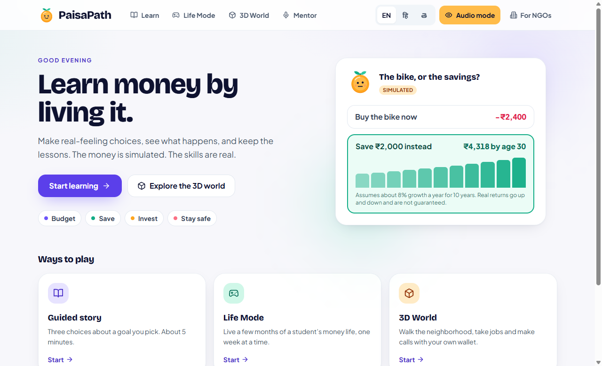
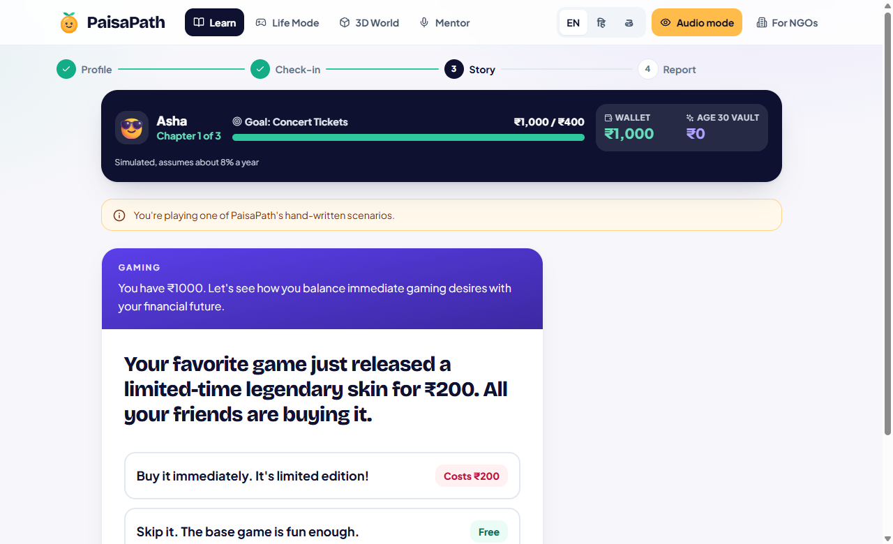
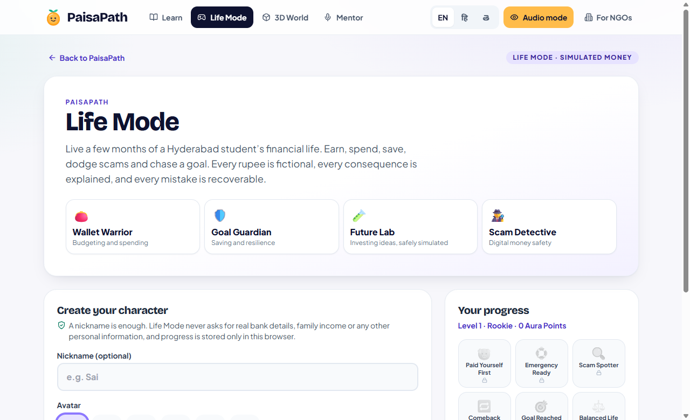
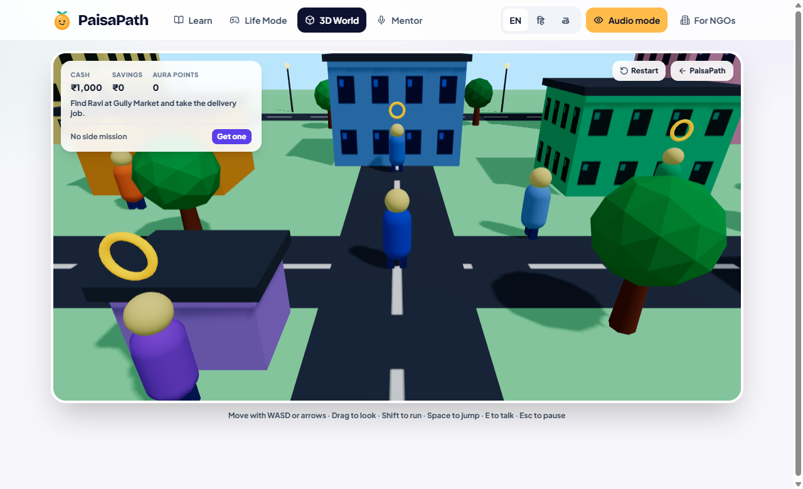
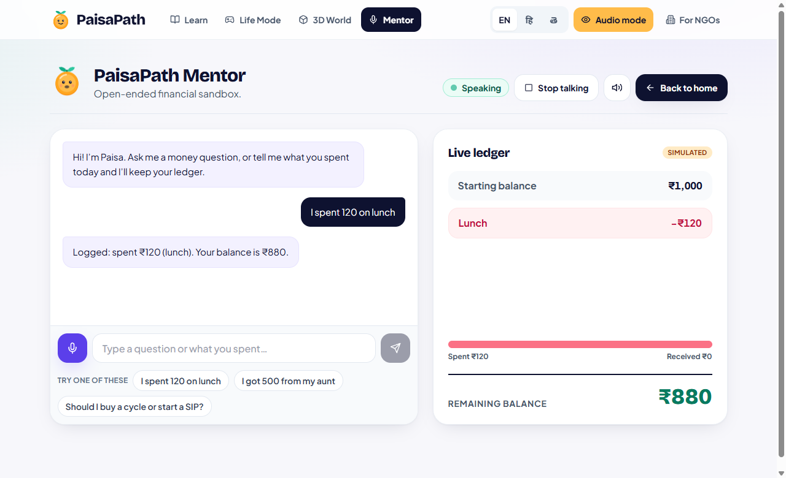

# PaisaPath

**Learn money by living it.** PaisaPath is a game-first financial literacy app for Indian students aged 16–17. Players make realistic money choices (spend or save, borrow or wait, trust the "guaranteed returns" message or not) and see what each choice leads to. All money is simulated; the lessons are real.

**Live demo:** _coming soon: add your Vercel link here_



## What you can do

| | |
|---|---|
|  |  |
| **Learn Mode**: a short profile and check-in, then a three-chapter story about a goal you pick, ending in a personal money-style report. | **Life Mode**: live a few months of a Hyderabad student's life, week by week, with scams to spot, an emergency fund to build and a Future Lab for investing ideas. |
|  |  |
| **3D World**: walk a neighbourhood, take jobs, and decide whether to buy a bike now or save, with borrowing costs and growth shown along the way. | **Mentor**: ask money questions or say what you spent, by voice or text, and watch a live ledger update. |

Also included:

- **Accessible Audio Mode**: a high-contrast, voice-first screen for blind and low-vision students. Hold the Spacebar (or the on-screen button) to speak, and answers are read aloud.
- **Three languages**: English, Hindi and Telugu across the interface.
- **Works fully offline**: every mode has built-in scenarios and an offline mentor. Optional Google Gemini AI adds personalised stories and answers when a server key is configured.

## Tech stack

- **React 18** with **Vite 5**, **Tailwind CSS 3** and **Framer Motion**
- **three.js**, **React Three Fiber** and **drei** for the 3D World
- **Web Speech API** for speech recognition and text-to-speech
- **Google Gemini API** behind a small **Vercel serverless function** (`api/gemini.js`), so the API key never reaches the browser
- **Vitest** for unit tests, and TypeScript type-checking (`checkJs`) for the Life Mode game engine

## Run it locally

Requirements: Node.js 18 or newer, and a modern browser (Chrome or Edge recommended for voice; WebGL is needed for the 3D World).

```bash
git clone https://github.com/suhaasps3-rgb/megathon.git
cd megathon
npm install
npm run dev
```

Open the address printed in the terminal (usually http://localhost:5173).

### Optional: AI features

The app runs fully without a key. To turn on AI-generated stories and mentor answers, copy `.env.example` to `.env` and set your Gemini key:

```
GEMINI_API_KEY=your_key_here
```

The key is read only by the dev server and the serverless function. It has no `VITE_` prefix, so it is never bundled into the browser code. Never commit `.env`.

### Other commands

```bash
npm test          # unit tests
npm run check     # type-check + tests + production build
npm run build     # production build into dist/
npm run preview   # serve the production build locally (includes the AI proxy)
```

## Deploy to Vercel

1. Import the repository in Vercel. The Vite preset is detected automatically.
2. Optional: under **Settings → Environment Variables**, add `GEMINI_API_KEY`. Without it, the app runs in offline mode.
3. Deploy. Link previews (Open Graph image and URL) use the production domain automatically.

The AI endpoint only accepts PaisaPath's own three tasks, limits how often each visitor can call it, and falls back to offline content when Gemini is slow or unavailable. Setting a usage quota on the key in Google AI Studio is still recommended.

## About the data

- All balances, returns and "age 30" figures are simulations. Growth assumes about 8% a year and is labelled as an assumption, not a promise.
- The **For NGOs** dashboard is a concept preview filled with made-up demo numbers. No real students or pilot data are shown.
- Life Mode progress is stored only in the browser. The app asks for no personal or financial details.

## Credits

Built at Megathon 2026 for a financial-literacy problem statement sponsored by Vanguard. PaisaPath is an independent student project and is not affiliated with or endorsed by Vanguard.

Third-party software: React, Vite, Tailwind CSS, Framer Motion, three.js, React Three Fiber and drei (MIT); Lucide icons (ISC); fonts from Google Fonts (SIL Open Font License).
